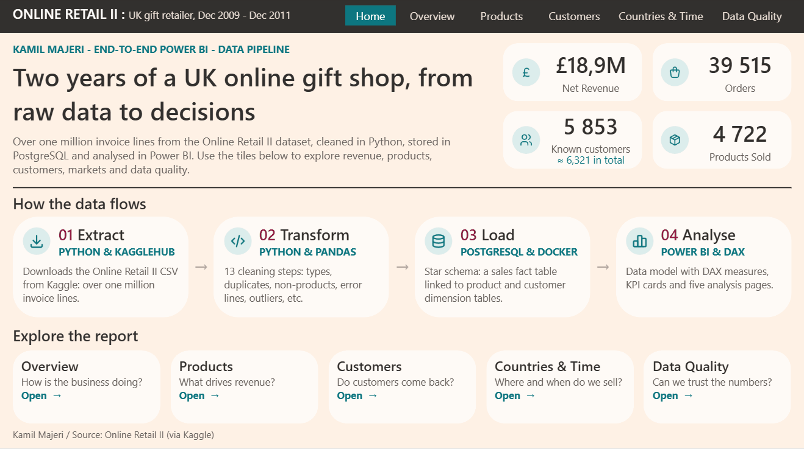
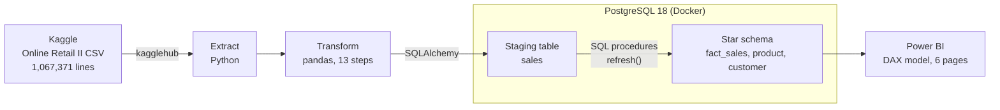
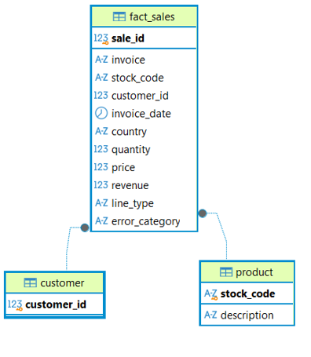
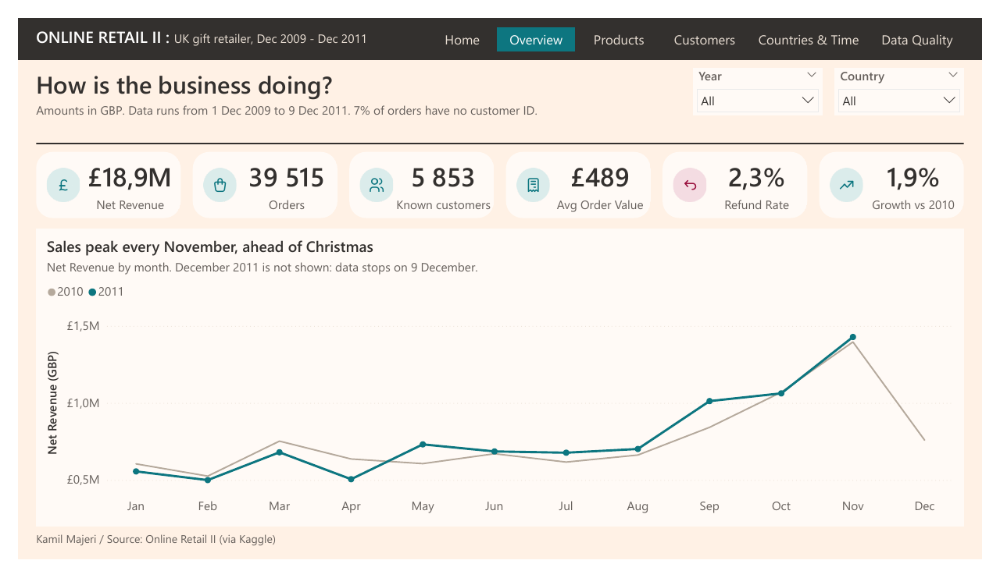
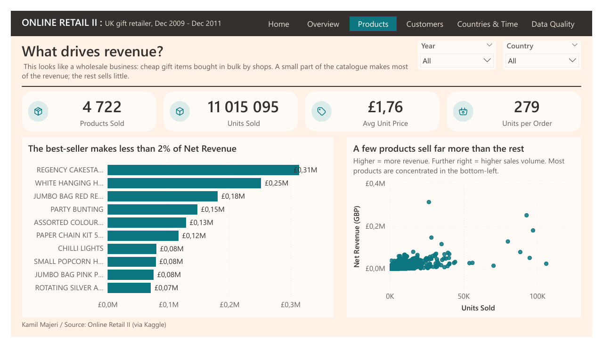
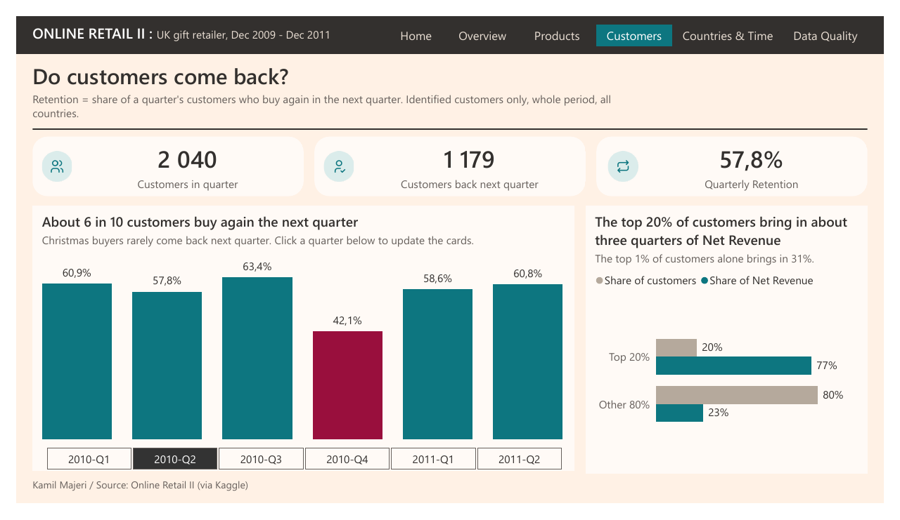
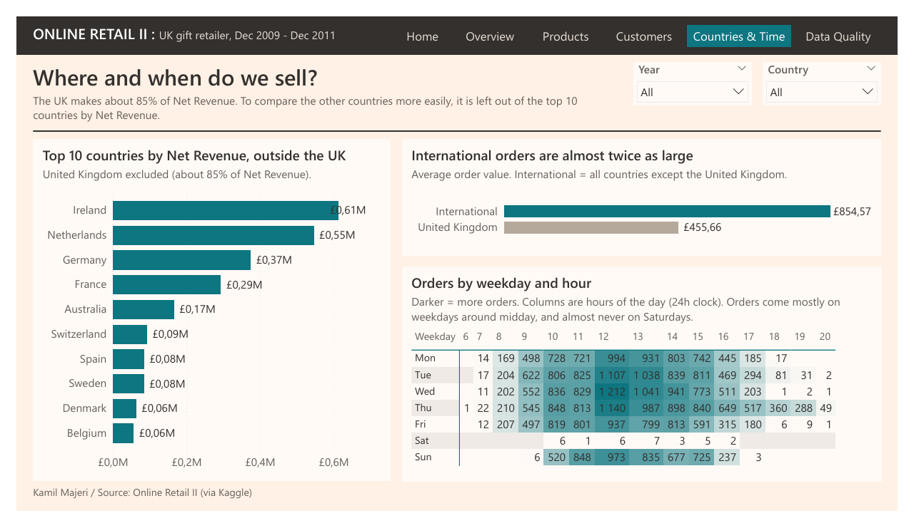
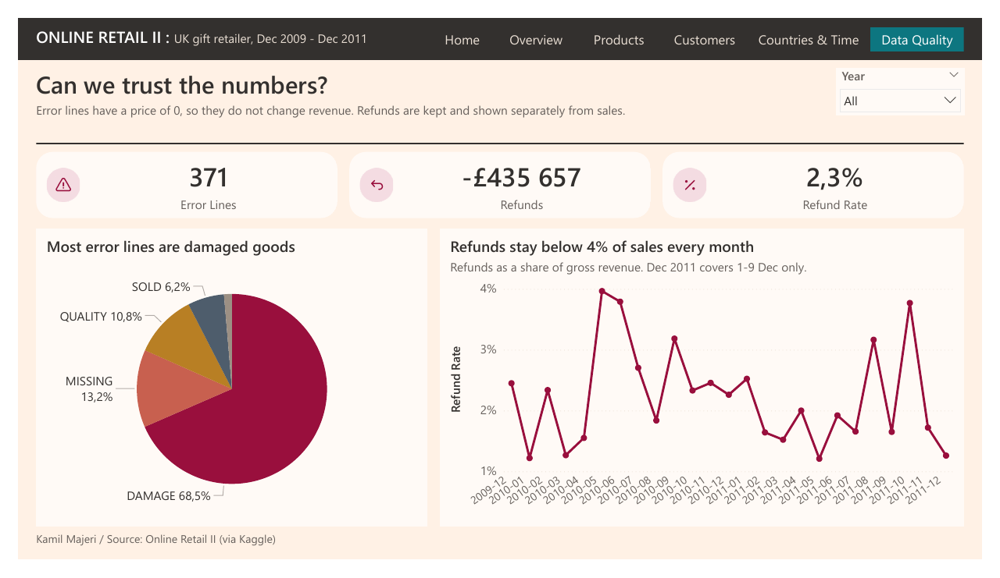

# Online Retail II: an end-to-end data pipeline, from raw CSV to Power BI


**Kamil Majeri**, 2nd-year BUT Informatique student, looking for a **data internship from April 2027**.
Contact: [kamilmajeri07@gmail.com](mailto:kamilmajeri07@gmail.com)



**Quick links:** [Full report (PDF)](powerbi/online-retail.pdf) · [Cleaning notebook](notebook/transform_walkthrough.ipynb) · [Power BI project](powerbi/)


## About the project

Online Retail II is a public dataset of over one million invoice lines from a UK online wholesaler of gifts and home decoration, from **December 2009 to December 2011**.

I built the whole chain myself: download the raw data, clean it in Python, store it in a PostgreSQL star schema, then analyse it in a Power BI report that answers five business questions.

| Page | Question |
|---|---|
| Overview | How is the business doing? |
| Products | What drives revenue? |
| Customers | Do customers come back? |
| Countries & Time | Where and when do we sell? |
| Data Quality | Can we trust the numbers? |

## Key insights

- **£18.9M net revenue** over two years, from 39,515 orders. Sales **peak every November**, ahead of Christmas.
- The **UK makes about 85%** of revenue, but **international orders are almost twice as large** (£855 vs £456 on average).
- **About 6 in 10 customers buy again the next quarter**. It drops to 42% after Christmas 2010: holiday buyers rarely come back.
- The **top 20% of customers bring in about three quarters** of net revenue.
- **Refunds stay low (2.3%)** of gross revenue. The 371 order-error lines are mostly damaged goods.

## How the data flows



`src/main.py` runs the whole pipeline in one command: extract, transform, load into the `sales` staging table, then fill the star schema with the SQL procedures in `sql/`.

## Data cleaning

Every decision is explained and measured in the [notebook](notebook/transform_walkthrough.ipynb): finding, decision, application, measurement, check.

**1,067,371 raw lines → 1,021,821 clean lines (4.3% removed).**

<details>
<summary>The 13 cleaning steps</summary>

| # | Step | Lines removed | What it does |
|---|---|---:|---|
| 1 | fix_types | 0 | Customer ID to integer, dates to datetime |
| 2 | normalize_text | 0 | Trim spaces, uppercase codes and descriptions |
| 3 | standardize_countries | 0 | EIRE → Ireland, RSA → Republic of South Africa, etc. |
| 4 | remove_duplicates | 34,335 | Lines recorded twice |
| 5 | remove_missing_descriptions | 4,275 | No description and always a price of 0 |
| 6 | remove_non_products | 5,620 | Postage, bank charges, adjustments, tests… |
| 7 | categorize_errors | 0 | Damaged, missing, mixed-up goods → 5 error categories (kept for analysis) |
| 8 | remove_zero_prices | 1,238 | Other zero-price lines that are not sales |
| 9 | classify_lines | 0 | New `line_type` column: sale / refund / error |
| 10 | unify_descriptions | 0 | One description per product |
| 11 | remove_outliers | 82 | 15 inconsistent invoices: huge orders cancelled the same day, duplicates |
| 12 | fill_unknown_customers | 0 | Missing customer → `-1` |
| 13 | add_revenue | 0 | Revenue = Price × Quantity (negative for refunds) |

</details>

## Data model



A **star schema** in PostgreSQL: one fact table (`fact_sales`, one row per invoice line) linked to two dimension tables (`product`, `customer`). Check constraints ensure that every `error` line has an error category, and only them.

In Power BI, the model adds:
- a **Calendar** table;
- a **Customers by Quarter** table, used to measure quarterly retention;
- **17 DAX measures**, grouped in folders: revenue, orders and customers, time comparison, products, retention, data quality.

<details>
<summary>Report screenshots</summary>







</details>

## How to run

Requirements: Python 3.14, Docker, and Power BI Desktop (Windows) to open the report.

```bash
git clone https://github.com/kamilai69/online-retail-etl-pipeline.git
cd online-retail-etl-pipeline
cp .env.example .env              # database settings
docker compose up -d              # starts PostgreSQL
pip install -r requirements.txt
python src/main.py                # downloads, cleans and loads the data
```

Then open `powerbi/online-retail.pbip` and click **Refresh**. Power BI asks for the database user and password: use the ones in your `.env`.

## Repository structure

| Folder / file | Content |
|---|---|
| `src/` | Python pipeline (extract, transform, load, model) |
| `sql/` | Tables and procedures of the star schema |
| `notebook/` | Cleaning walkthrough, step by step |
| `powerbi/` | Power BI project (PBIP) and PDF export |
| `docs/images/` | README images |
| `docker-compose.yml` | PostgreSQL container |
| `requirements.txt` | Python libraries |

## Limitations

- The data stops in December 2011, so there is no recent trend.
- 22% of lines have no customer ID: they count in revenue, but not in customer analyses.
- No cost data, so no margin analysis.
- Some cleaning choices are assumptions, for example "Korea" read as South Korea. They are all documented in the notebook.

## License

This project is under the [MIT License](LICENSE): you can use, modify and share it freely, as long as you credit me. If you use it, I'd be happy to hear about it: [kamilmajeri07@gmail.com](mailto:kamilmajeri07@gmail.com).

## About me

I'm Kamil Majeri, a 2nd-year **BUT Informatique** student at **IUT Lyon 1 (Université Claude Bernard)**. I'm looking for:
- a **data internship of 8 to 12 weeks**, starting on **6 April 2027**;
- then a **data apprenticeship** from **September 2027** (1 week in the company / 1 week at school).

Contact: [kamilmajeri07@gmail.com](mailto:kamilmajeri07@gmail.com)


*Data source: [Online Retail II](https://archive.ics.uci.edu/dataset/502/online+retail+ii) (UCI Machine Learning Repository), downloaded from Kaggle.*
